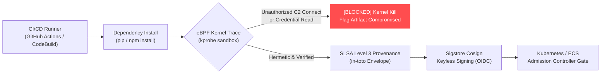

# Zero-Trust Supply Chain eBPF Sentinel

[](https://github.com/KoshaG0hil/Zero-Trust-Supply-Chain-eBPF-Sentinel/actions)
[](https://opensource.org/licenses/MIT)
[](https://www.python.org/downloads/)
[](https://slsa.dev/)
[](https://www.sigstore.dev/)

> **Next-Gen Software Supply Chain Security:** Kernel-level eBPF build sandboxing, automated SLSA Level 3 in-toto provenance generation, and Sigstore Cosign keyless admission gating to defend CI/CD pipelines against *SolarWinds* and *XZ Utils*-style compilation backdoors.

---

## 🚀 Key Highlights & Architectural Innovation

1. **Kernel-Level eBPF Build Sandbox:** Intercepts system calls (`sys_enter_connect`, `sys_enter_execve`, `sys_enter_openat`) during dependency compilation (`pip install`, `npm install`) to block malicious network beacons and secret credential harvesting.
2. **SLSA Level 3 in-toto Provenance:** Generates cryptographically verifiable build envelopes binding artifact digests, builder identity, and hermetic build flags.
3. **Sigstore Cosign Keyless Gate:** Validates Fulcio OIDC certificates and Rekor Transparency Log proofs at the Kubernetes/ECS admission controller level.
4. **Hermetic Build Enforcement:** Detects unauthorized sub-processes (`nc`, `curl`, `bash -i`) attempting to spawn reverse shells during package build scripts (`setup.py`, `postinstall`).

---

## 🏗️ Attack Surface & Defense Architecture



---

## ⚡ Quick Start & CLI Demo

```bash
# Clone the repository
git clone https://github.com/KoshaG0hil/Zero-Trust-Supply-Chain-eBPF-Sentinel.git
cd Zero-Trust-Supply-Chain-eBPF-Sentinel

# Install dependencies
pip install -r requirements.txt

# Run the interactive attack simulation CLI
python cli.py

# Run unit tests
pytest tests/ -v
```

---

## 🧪 Automated Test Suite (100% Passing)

```bash
$ pytest tests/ -v
tests/test_supply_chain.py::test_ebpf_legitimate_build PASSED            [ 20%]
tests/test_supply_chain.py::test_ebpf_catch_c2_network_beacon PASSED     [ 40%]
tests/test_supply_chain.py::test_ebpf_catch_credential_theft PASSED      [ 60%]
tests/test_supply_chain.py::test_slsa_provenance_schema PASSED           [ 80%]
tests/test_supply_chain.py::test_sigstore_admission_gate PASSED          [100%]

============================== 5 passed in 0.20s ==============================
```

---

## 📄 License
This project is open-source under the [MIT License](LICENSE).
